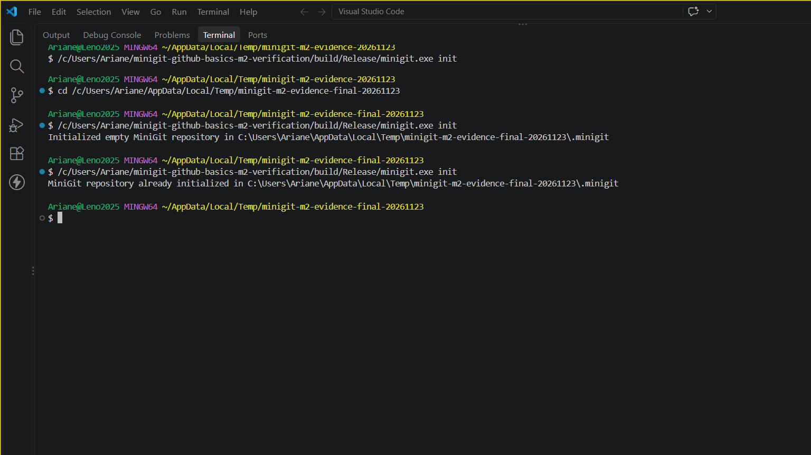

# M2 init verification and submission evidence

## Verified main revision

- Repository: [minigit-github-basics](https://github.com/PhyoThihaOo32/minigit-github-basics)
- Main commit tested: [`b22dd6e6a084c49d517df34b030bdf8203a43912`](https://github.com/PhyoThihaOo32/minigit-github-basics/commit/b22dd6e6a084c49d517df34b030bdf8203a43912), merge commit for PR #68.
- Latest main CI: [workflow run 45249405115](https://github.com/PhyoThihaOo32/minigit-github-basics/actions/runs/45249405115). The Ubuntu and Windows jobs both completed successfully.
- Local platform: Windows 11, Visual Studio 2022 generator, Release configuration.

## Build and CTest

Run these commands from the repository root:

```sh
cmake -S . -B build
cmake --build build --config Release
ctest --test-dir build -C Release --output-on-failure
```

Observed on the tested main commit: configuration succeeded, the Release build succeeded, and CTest passed **10/10 tests**. The `minigit_init_integration` CTest case is included in that total.

## Running the executable

The executable must run with the project being initialized as its working directory. Use an absolute path to the built executable.

macOS/Linux:

```sh
cd /path/to/a/separate/project-folder
/absolute/path/to/minigit-github-basics/build/minigit init
```

Windows PowerShell, with a Release build:

```powershell
Set-Location C:\path\to\a\separate\project-folder
& 'C:\absolute\path\to\minigit-github-basics\build\Release\minigit.exe' init
```

For repeat initialization, run the same command again from that same project folder. Keep verification project folders outside the repository and remove only folders created for the verification.

## Executable scenario results

Each scenario was run against the built Windows Release executable from a fresh, test-owned temporary folder. The repeated-init scenario used one folder for both invocations and compared the complete file and directory snapshot before and after the second run.

| Scenario | Expected result | Observed result |
|---|---|---|
| Empty project folder | Exit 0; success message; only documented `.minigit` layout with empty `HEAD` and `index.txt`, `next-id.txt`=`1` plus LF, and empty `stage/` and `commits/`. | Passed: exit 0, success message, exact entries and initial contents verified. |
| Valid repository, init run again | Exit 0; already-initialized message; metadata, staged files, committed files, and working files unchanged. | Passed: exit 0; message matched; full before/after tree snapshot was identical, including `HEAD`, `index.txt`, `next-id.txt`, stage file, commit file, and working file. |
| Damaged repository missing `HEAD` | Exit 1; `Error:` on stderr; no repair and no changes to remaining data. | Passed: exit 1; `Error:` on stderr; no stdout; `HEAD` stayed absent and the rest of the tree was unchanged. |
| Unknown command | Exit 1; `Error:` on stderr; no metadata created. | Passed: exit 1; error on stderr; no `.minigit` created. |
| Unsupported `status` command | Exit 1; `Error:` on stderr; no metadata created. | Passed: exit 1; error on stderr; no `.minigit` created. |
| No command | Exit 1; `Error:` on stderr; no metadata created. | Passed: exit 1; error on stderr; no `.minigit` created. |
| Extra `init` arguments | Exit 1; `Error:` on stderr; no metadata created. | Passed: exit 1; error on stderr; no `.minigit` created. |
| `.minigit` is an ordinary file | Exit 1; `Error:` on stderr; preserve the original file and bytes. | Passed: exit 1; error on stderr; original file and contents remained unchanged. |

## Submission screenshot

The screenshot below is a real capture of the VS Code integrated terminal. It shows the built Windows Release executable running twice from the same fresh temporary project folder: the first run creates the repository, and the second reports that it is already initialized.

[](submission/m2-init-twice.png)

## M2 links and status

- [Issue #69: M2 Verify init and document submission evidence](https://github.com/PhyoThihaOo32/minigit-github-basics/issues/69)
- [Team 1 MiniGit board](https://github.com/users/PhyoThihaOo32/projects/4)
- [M2 milestone](https://github.com/PhyoThihaOo32/minigit-github-basics/milestone/2)
- [PR #65: Initialize repository](https://github.com/PhyoThihaOo32/minigit-github-basics/pull/65)
- [PR #66: CLI init command](https://github.com/PhyoThihaOo32/minigit-github-basics/pull/66)
- [PR #68: executable integration tests](https://github.com/PhyoThihaOo32/minigit-github-basics/pull/68)
- [Ariane's approval review of PR #68](https://github.com/PhyoThihaOo32/minigit-github-basics/pull/68#pullrequestreview-6028093990)

The `minigit init` CLI and its executable-level integration tests are implemented and merged. PR #65 contains initialization, PR #66 adds CLI dispatch, and PR #68 adds the executable integration suite. The latest main CI is green on both Ubuntu and Windows.
